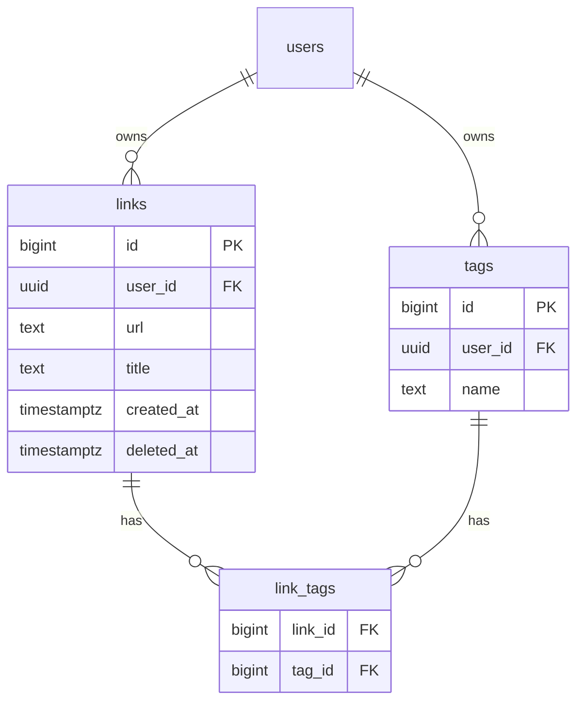

# Linkbox

YouTube の動画・チャンネルや SNS アカウントなどのリンクを、タグで整理できる Web サービスです。

**公開先：** https://linkbox-virid.vercel.app

## できること

- リンクの登録・編集・削除
- タグ付け（1つのリンクに複数のタグ）
- タグの複数選択による絞り込み（AND 検索）
- YouTube の URL を登録すると、動画タイトル・チャンネル名を自動で取得
- 削除の取り消し（論理削除）
- ユーザー登録・ログイン（自分のリンクは自分にしか見えない）
- スマートフォン対応

## 使用技術

| 分類 | 技術 |
|---|---|
| フロントエンド / サーバー | Next.js（App Router, Server Components, Server Actions）, TypeScript |
| スタイル | Tailwind CSS |
| データベース / 認証 | Supabase（PostgreSQL, Auth, Row Level Security） |
| 外部 API | YouTube oEmbed, YouTube Data API v3 |
| ホスティング | Vercel |

## 工夫した点

- **ユーザーごとのデータ分離を DB 側で保証**：Supabase の Row Level Security（RLS）で「持ち主が自分の行だけ読み書きできる」ようにし、アプリのコードにミスがあっても他人のデータが見えない設計にしました
- **タグの多対多設計**：リンク・タグ・対応表の3テーブル構成。タグ名はユーザーごとに重複しないよう制約を付けています
- **論理削除と取り消し**：削除時は行を消さずに `deleted_at` を記録。「元に戻す」でタグ付きのまま復元できます。URL の重複禁止は、削除されていない行の中だけに効く部分インデックスで実現しています
- **YouTube 名の自動取得**：動画は APIキー不要の oEmbed、チャンネルは YouTube Data API を使い分け、APIキーはサーバー側だけで扱っています

## データベース設計



テーブル作成・RLS の SQL は [`supabase/schema.sql`](supabase/schema.sql) にまとめています。

## ローカルでの動かし方

1. Supabase のプロジェクトを作成し、`supabase/schema.sql` の内容を実行
2. `.env.local` を作成

3. 起動

```bash
   npm install
   npm run dev
```

4. http://localhost:3000 を開く

## 今後追加したい機能

- ゴミ箱ページ（削除したリンクの一覧）
- 使われていないタグの自動整理
- スマートフォンの共有ボタンからの登録
